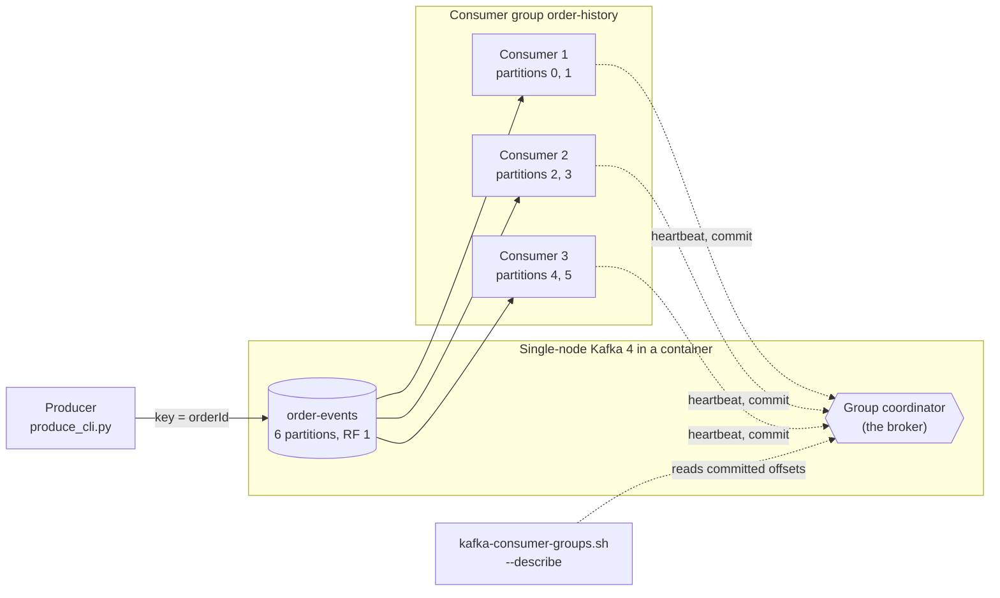

# Architecture: the order-events stream

This document describes what the code in this repository does and why it is shaped this way. Component names match the diagram in the lesson ("The order-events stream you build"): **Producer**, **order-events**, **Consumer group order-history** with its **Consumer 1, 2 and 3**, all on a **single-node Kafka 4 in a container**.

## Components and what each owns

| Component | Where it lives | What it owns |
| --- | --- | --- |
| **Producer** | use case [`application/produce_orders.py`](src/order_events/application/produce_orders.py), adapter [`infrastructure/kafka_publisher.py`](src/order_events/infrastructure/kafka_publisher.py), program [`interfaces/produce_cli.py`](src/order_events/interfaces/produce_cli.py) | Turns orders into events and sends them, keyed by `orderId` (or unkeyed on purpose). The event type and the interleaving of open orders are domain code ([`domain/events.py`](src/order_events/domain/events.py)); the JSON wire format is [`infrastructure/codec.py`](src/order_events/infrastructure/codec.py). |
| **order-events** (topic) | created by `make up` | The log: six partitions, replication factor 1, seven-day retention. Owns the ordering guarantee (within one partition) and nothing else. |
| **Consumer group order-history** | `GROUP_ID`, default `order-history` | The set of consumers that share the topic's partitions. Kafka assigns each partition to exactly one member. |
| **Consumer 1, 2, 3** | use case [`application/read_orders.py`](src/order_events/application/read_orders.py), adapter [`infrastructure/kafka_source.py`](src/order_events/infrastructure/kafka_source.py), program [`interfaces/consume_cli.py`](src/order_events/interfaces/consume_cli.py), started N times by [`scripts/scale.sh`](scripts/scale.sh) | Reads its partitions, tracks the last `sequence` per order with [`domain/ordering.py`](src/order_events/domain/ordering.py) and prints each order's history. Commits its offsets (auto-commit every second and on close). |
| **Group coordinator** | a broker (here the only one) | Tracks members through heartbeats, runs the rebalance, stores committed offsets in `__consumer_offsets`. Not code in this repository, but every lag number comes from it. |
| **Single-node Kafka 4 in a container** | [`docker-compose.yml`](docker-compose.yml) | One `apache/kafka:4.0.0` process in KRaft mode, acting as broker and controller. No ZooKeeper. |
| **Lag reader** | [`domain/lag.py`](src/order_events/domain/lag.py), adapter [`infrastructure/kafka_offsets.py`](src/order_events/infrastructure/kafka_offsets.py), `make lag-report`, and `kafka-consumer-groups.sh` | Log-end offset minus committed offset, per partition. |

The event, an ordinary JSON object:

```json
{"orderId": "order-00042", "type": "OrderPaid", "sequence": 2, "ts": 1793043251.3}
```

`sequence` counts 1, 2, 3 within one order. It exists only so a consumer can notice when an event arrives out of order.

## Pattern: ports and adapters

The ordering rules, the produce plan and the read loop are the point of the lesson, so they sit in `domain` and `application` and know nothing about Kafka. Four ports (`EventPublisher`, `EventSource`, `OffsetReader`, `HealthProbe`) are the only things the use cases ask for; the adapters in `infrastructure` implement them with `kafka-python`, and the programs in `interfaces` wire them together. Time, randomness and sleeping are passed in as functions, so the unit tests run in milliseconds and are deterministic. Why, and what was rejected: [ADR 0002](docs/adr/0002-ports-and-adapters-around-the-kafka-client.md). The dependency rule is enforced by import-linter in `make lint`.

## Data flow



### One run, step by step (`make run`)

1. `make reset-topic` deletes and recreates `order-events` with six partitions, so no id from an earlier run is in it.
2. The **Producer** builds 1,000 orders. `interleave()` (domain) keeps up to 50 orders open at once and sends the next event of a randomly chosen open order, so events of different orders mix while each order's own events stay in sequence.
3. For each event the producer calls `send(topic, key=orderId, value=json)`. The client hashes the key with murmur2 and takes it modulo six to choose the partition. The same key always gives the same partition.
4. The broker appends the record to that partition's log and acknowledges it. The producer flushes at the end and prints how many events it sent.
5. A **Consumer** joins the group `order-history` with `auto_offset_reset=earliest`. The **Group coordinator** assigns it all six partitions (it is alone) and the consumer logs `assigned partitions [0, 1, 2, 3, 4, 5]`.
6. The consumer polls. The adapter decodes each record's JSON into an `OrderEvent` (a record that is not a valid event is logged and skipped). The `read_orders` use case asks the `OrderChecker` whether `sequence` is the last one seen for that order plus one, and appends the event type to the order's history. A mismatch is logged as a warning (the first five) and counted.
7. After five seconds with no new events (`--until-idle 5`) or on SIGINT or SIGTERM, the consumer stops polling, closes (which commits its offsets and leaves the group) and prints the summary line and the history of the first three orders: `OrderPlaced -> OrderPaid -> OrderShipped`, each with its partition.

Expected result: `out-of-order events logged: 0` and `orders spread over more than one partition: 0`.

## Decisions and trade-offs

**Topic `order-events`.** One topic for the whole lifecycle of an order, with the event type inside the payload. The alternative, one topic per type, would put an order's `OrderPlaced` and `OrderPaid` on different logs with no ordering between them.

**Key `orderId`.** Kafka orders records only within a partition, so the key must be the entity whose events must stay in sequence. Here one order's lifecycle must stay in order, so the key is the order id. Everything else (different orders) is allowed to interleave. **What would change the key:** a reader that needs every event of one *customer*, across all of that customer's orders, in one ordered stream (for example a fraud check that counts a customer's orders per minute). Only one key's events share a partition, so that reader needs `customerId` as the key, and then one order's events are still ordered (they share the customer) but a hot customer concentrates load on one partition.

**Six partitions.** The partition count is the ceiling on parallelism inside one group: at most six consumers do work, the rest sit idle (shown by `make scale N=8`). Six is above the three consumers this service runs and leaves room to double. It can be raised later but never lowered, and raising it changes which partition a key maps to, so for a while an order's old and new events can sit on different partitions. Choosing a count comfortably above the expected consumer count avoids that repartition.

**Retention seven days** (`retention.ms=604800000`). Enough to replay after an outage that runs over a weekend, without unbounded disk. The default (seven days as well) is set explicitly so the design is visible in `kafka-topics.sh --describe`.

**Replication factor 1.** There is one broker, so there can be only one replica. `Isr: 1` only says the single copy is in sync with itself. Losing the container's disk loses every event. This is acceptable for a throwaway local cluster and is the first thing the [`kafka-durable-pipeline`](../kafka-durable-pipeline) project changes.

**Producer acknowledgments.** The pinned client, `kafka-python` 3.0.12, defaults to `acks=all` with idempotence on. With one replica that waits for the leader alone, so it costs nothing here and becomes meaningful once there are three replicas.

**Group size.** The default is whatever you start. `make scale N=3` shows two partitions per consumer; `make scale N=8` shows six consumers with one partition each and two with none.

**Offsets: auto-commit every second.** Simple and good enough for a reader that only prints. It means a crash can re-read up to a second of events. The idempotent-consumer project replaces this with commits after the work is done.

**Operability.** Structured `logfmt` log lines on standard error (levels, no secrets), results on standard output. `SIGINT` and `SIGTERM` stop the poll loop between events, so the consumer commits and leaves the group instead of waiting for its session to expire. Configuration comes from the environment and is validated at startup (`infrastructure/settings.py`); a bad value exits with code 2 and names the variable. Kafka clients get explicit `request_timeout_ms` and `retry_backoff_ms`; the one-off offset reads and the health probe retry with exponential backoff and jitter (`infrastructure/retry.py`). `make health` is the health command; the image's `HEALTHCHECK` runs it.

## Failure modes the lesson teaches, and how to reproduce each

| Failure | What you see | How to reproduce |
| --- | --- | --- |
| **No key** | Events of one order land on different partitions and arrive out of order: hundreds of `out-of-order` lines, `orders spread over more than one partition` close to the order count. | `make run-unkeyed` sends the same events with `key=None` into the same topic (same six partitions, so only the key differs) and checks only that run's orders. |
| **Too many consumers** | Two of eight members own no partition. | `make scale N=8`, read `#PARTITIONS` in the members table. |
| **A stopped consumer and its lag** | Lag per partition grows while no consumer runs, then falls once one reads. | `make lag`: catches the group up, stops it, produces about 50,000 events, prints the lag table, starts one slow consumer and prints the total every ten seconds until it reaches zero. |
| **A rebalance** | Every join or leave pauses the group while partitions are reassigned. | `make scale N=3` starts consumers two seconds apart; each logs `assigned partitions [...]` again when the group changes. Stop one with `kill` and the others log a new assignment. |
| **Reading a transient assignment** | A `--describe` taken mid-rebalance shows a partial assignment. | `scripts/scale.sh` waits eight seconds after the last join before describing. Remove the wait to see it. |

## Limits of the teaching build against production

- **One broker, replication factor 1:** no durability and no failover. Production runs three or more brokers, replication factor 3 and `min.insync.replicas=2`.
- **No schema management:** the event is bare JSON. Production uses a schema registry and compatible evolution rules.
- **Plain-text, unauthenticated listener:** production uses TLS and SASL or mTLS, with ACLs per topic and group.
- **Auto-commit and no error handling:** a malformed event would crash the consumer. Production has a dead-letter path and metrics.
- **Lag measured by hand:** `make lag-report` and `kafka-consumer-groups.sh` give one reading; production exports lag per partition as a metric and alerts on its trend.
- **Synthetic load from one process:** the producer is one thread with a small random pause; real producers are many services with bursts.
- **No consumer-side ordering across partitions:** the checker only knows each order's sequence. Nothing here orders events of different orders, and nothing should.

## How to extend it

- **Another event type** (`OrderCancelled`): add it to `EventType` in `domain/events.py`. `lifecycle_events`, the codec and the checker pick it up, because the checker only expects each sequence to be the previous one plus one.
- **Order by customer:** add `customerId` to the event, change the key in `application/produce_orders.py`, and re-run `make run`. Check that one customer's events share a partition and that the per-order check still passes.
- **A real consumer action:** replace the history printing in `interfaces/consume_cli.py` with a write to a store, and read the idempotent-consumer project for how to make that write safe on redelivery.
- **More brokers:** see the three-broker cluster in [`kafka-durable-pipeline`](../kafka-durable-pipeline).
- **Metrics:** call `group_lag()` from `application/group_lag.py` on a timer and export the numbers.
